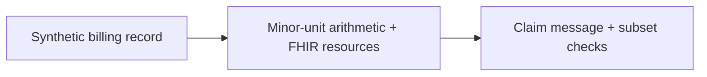

# nphies-claim-bundle-sample

Build a synthetic professional-claim FHIR message with NPHIES event coding, closed references, and transparent amount checks. Offline only; no submission endpoint is contacted.

[](https://github.com/code-rowthtech/nphies-claim-bundle-sample/actions/workflows/ci.yml)

Educational sample using synthetic data. The badge above reports the actual GitHub Actions status; passing local tests does not imply exchange acceptance or production readiness.

## The problem it solves

Before implementing a live claims integration, a team needs to understand how billing items, coverage, patient and organization resources connect inside a message, and how to catch mismatched amounts before sending anything.

All bundled data is invented and synthetic. No real people, production exports, client code, provider credentials or licensed procedure-code datasets are included.

## How it works



The builder emits a message Bundle with MessageHeader first, a professional Claim, Patient, two Organizations and Coverage. References use full `urn:uuid` URLs and resolve within the bundle. The header uses the NPHIES `claim-request` event and example provider/payer routing identifiers.

Amounts enter as integer minor units, such as `unitPriceMinor: 1250` for SAR 12.50. Quantity must be a positive integer; unsafe totals and fractional minor-unit values are rejected. Claim totals and item amounts are validated after bundle creation. Each claim needs coded diagnoses with unique positive sequence numbers, and each item needs nonempty, unique links to those sequences. Malformed entries, items and diagnosis/link shapes produce validation findings instead of throwing. Only SAR is accepted in this sample.

Reference reviewed: the public NPHIES Healthcare Financial Services IG Edition 1, version 1.0.0, on 13 November 2026. Local rules check references, dates, message identity/routing, selected required values, item sequences, diagnosis links and amounts. They do not implement every NPHIES profile constraint, extension, code binding, tax rule, encounter requirement, care-team rule, preauthorization rule or payer business rule.

The output does not assert `meta.profile` conformance. Synthetic diagnosis/service code systems and license/member IDs are intentionally not production code values. The sample is ready for its documented offline educational scope. Full current-IG validation and specialist review are separate requirements for a real integration; passing these local checks does not imply that NPHIES would accept the message.

## Run it in 3 commands

Requires Node.js 22.18+ and npm. Run from this repository's directory after cloning/extracting it:

```bash
npm ci --ignore-scripts
npm test
npm start
```

`npm run typecheck` checks types separately. TypeScript runs with native type stripping. No credentials, exchange access or environment variables are needed. `.env.example` contains no values. Nothing is submitted to an exchange.

## Sample input and output

Input: `sample-data/input.json`, including:

```json
{
  "claimId": "SYNTHETIC-CLAIM-001",
  "currency": "SAR",
  "items": [{"code": "SYNTHETIC-SERVICE-001", "quantity": 2, "unitPriceMinor": 1250}]
}
```

The full input also contains synthetic patient/member IDs, provider/payer identifiers, a diagnosis code and service date.

Expected summary:

```json
{
  "validForSampleRules": true,
  "exchangeValidated": false,
  "resources": 6,
  "output": "output/bundle.json"
}
```

`output/bundle.json` contains the built message; its claim total is SAR 25.00 for the fixture. `sample-data/expected-output.json` is an illustrative full generated message. UUIDs change on each run. Generated artifacts are ignored.

Tests cover closed references, dates, missing identifiers, message order, duplicated identities, money overflow/fractions and manipulated totals. CI runs tests, the demo, type checks and Gitleaks.

## What we would add in production

Validate against the exact agreed official NPHIES/FHIR package, add required profile elements/extensions and authorized terminology, implement clinical/tax/payer rules, verify national/provider IDs, add authorization references, and integrate approved exchange transport and sandbox tests. Introduce durable transaction IDs, reconciliation, secure credentials and operational monitoring. No production or regulatory acceptance is claimed here.

## Built by RowthTech

Independently written healthcare engineering sample. MIT licensed. Priority P1; GCC market.

Primary references consulted on 13 November 2026:

- [NPHIES artifact index and version](https://portal.nphies.sa/ig/artifacts.html)
- [NPHIES professional claim profile](https://portal.nphies.sa/ig/StructureDefinition-professional-claim.html)
- [FHIR R4 message Bundles](https://hl7.org/fhir/R4/bundle.html)

The original portfolio brief separately requests clean-copy runs, source/history secret scans, a second-engineer review, and Mukesh/Raavish approval before public release. These are publishing decisions, not requirements for running this offline sample. Real exchange use also needs current guide validation and sandbox acceptance.
